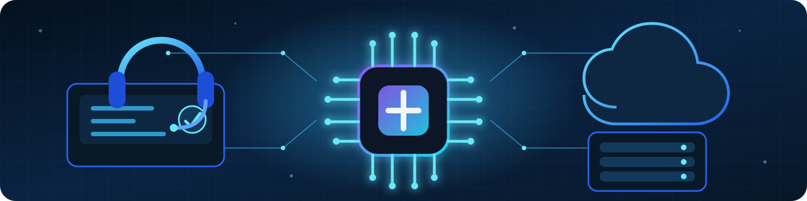

  

<h1 align="center">Cláudio Santos</h1>

<b>Analista de Suporte Júnior • Workplace • Microsoft 365 • Cloud • IA • Belo Horizonte, Brasil</b>

  
  
  

  
  
  
  

---

## Sobre mim

Sou Analista de Suporte Júnior e profissional de Workplace, com experiência no atendimento a usuários corporativos em ambientes Microsoft por e-mail, telefone, chat, suporte remoto, atendimento presencial e registro de chamados, sempre com foco no cumprimento de SLA, na resolução de incidentes e na continuidade operacional. Atuo com administração e sustentação do Microsoft 365, incluindo Exchange Online, Teams Admin Center, SharePoint Online, OneDrive, Microsoft Entra ID, Active Directory e Microsoft Defender, além de gestão de usuários, grupos, permissões, licenciamento, onboarding, solicitações de acesso e suporte a endpoints Windows. Também possuo experiência em troubleshooting de hardware, software e periféricos, monitoramento de infraestrutura com Zabbix, Grafana e OpMon em ambiente de NOC, documentação técnica e criação de bases de conhecimento. Sou certificado em Microsoft Azure Fundamentals (AZ-900) e Microsoft Azure AI Fundamentals (AI-900), curso Bacharelado em Inteligência Artificial e Machine Learning e continuo desenvolvendo conhecimentos em Azure, AWS, automação de processos, APIs, integrações e Python básico. Meu objetivo é evoluir profissionalmente nas áreas de suporte, workplace, infraestrutura, cloud e automação com inteligência artificial, contribuindo para ambientes mais seguros, organizados e eficientes.

---

## Skills

  
  
  
  
  

  
  
  
  

  
  
  
  
  
  

  
  
  
  
  

---

  
<b>Mostrar tradução em inglês</b>

   

  ## About me

  I am a Junior IT Support Analyst and Workplace professional with experience supporting corporate users in Microsoft-based environments through email, phone, chat, remote assistance, on-site support and ticket management, always focusing on SLA compliance, incident resolution and operational continuity. I work with the administration and support of Microsoft 365, including Exchange Online, Teams Admin Center, SharePoint Online, OneDrive, Microsoft Entra ID, Active Directory and Microsoft Defender, as well as user and group management, permissions, licensing, onboarding, access requests and Windows endpoint support. I also have experience troubleshooting hardware, software and peripherals, monitoring infrastructure with Zabbix, Grafana and OpMon in a NOC environment, producing technical documentation and building knowledge bases. I hold the Microsoft Azure Fundamentals (AZ-900) and Microsoft Azure AI Fundamentals (AI-900) certifications, and I am currently pursuing a Bachelor's degree in Artificial Intelligence and Machine Learning while developing skills in Azure, AWS, process automation, APIs, integrations and basic Python. My goal is to grow professionally across IT support, workplace, infrastructure, cloud and AI-powered automation, contributing to safer, more organized and efficient technology environments.

